<a href="https://tomglv.dev"><picture><source media="(prefers-color-scheme: dark)" srcset="assets/banner-dark.png">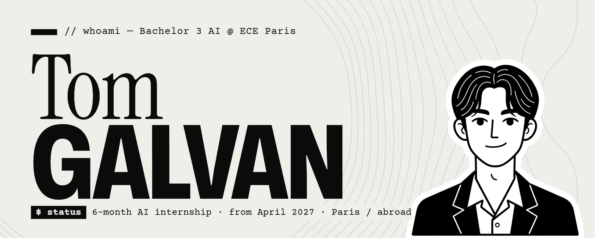</picture></a>

<picture><source media="(prefers-color-scheme: dark)" srcset="assets/typing-dark.svg"></picture>

Third-year **Bachelor in Artificial Intelligence** student at **ECE Paris**. I build end-to-end AI systems — a PyTorch 3D CNN behind a FastAPI service, LLM-vision document processing with human review, OCR → LLM pipelines — and ship them.
**Looking for a 6-month AI / ML internship from April 2027**, Paris or abroad.

<picture><source media="(prefers-color-scheme: dark)" srcset="assets/t-work-dark.png">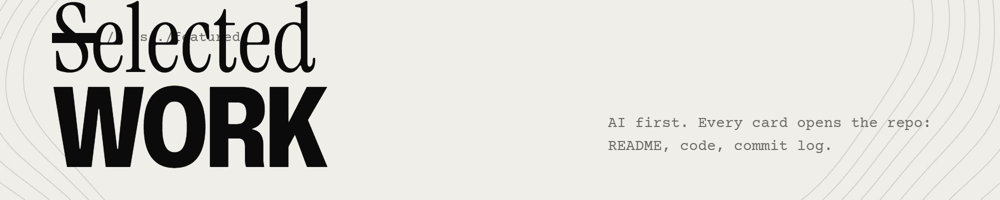</picture>

<a href="https://github.com/TomGlv/minecraft-house-ai"><picture><source media="(prefers-color-scheme: dark)" srcset="assets/card-0-dark.png">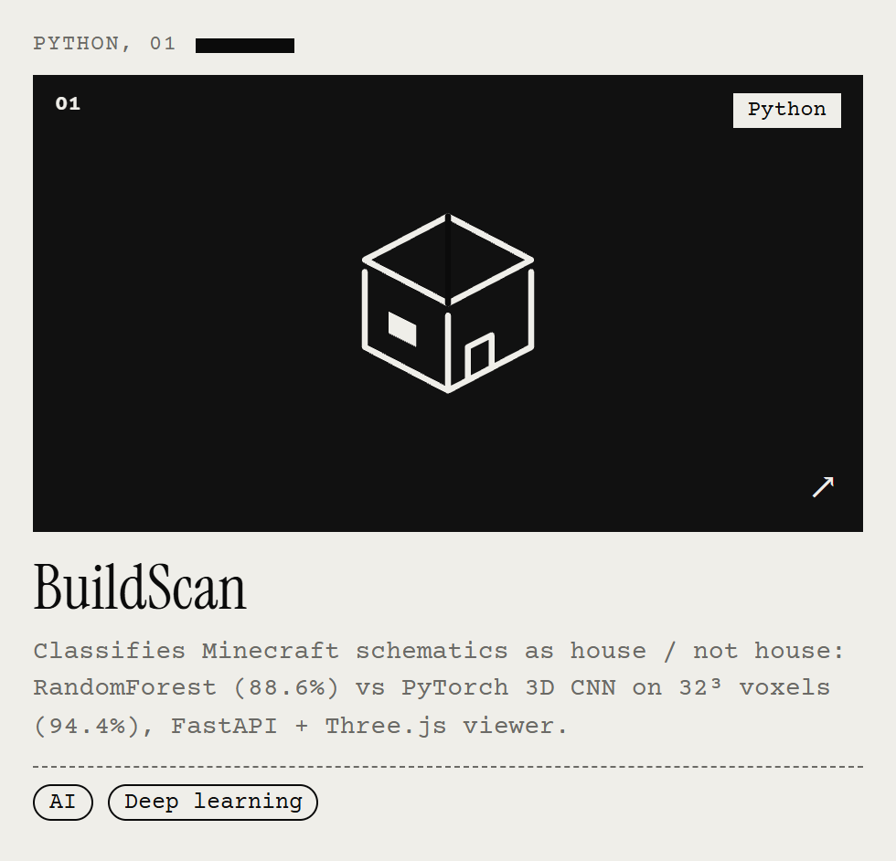</picture></a>
<a href="https://github.com/TomGlv/ai-pdf-sorter"><picture><source media="(prefers-color-scheme: dark)" srcset="assets/card-1-dark.png">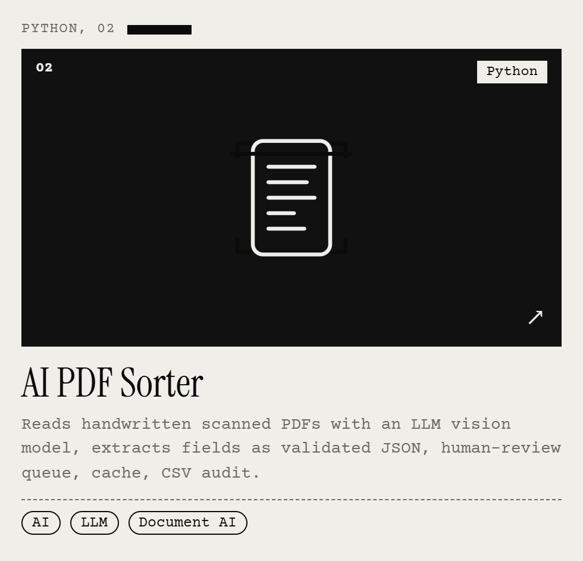</picture></a>

<a href="https://github.com/TomGlv/voltaire-ocr-llm"><picture><source media="(prefers-color-scheme: dark)" srcset="assets/card-2-dark.png">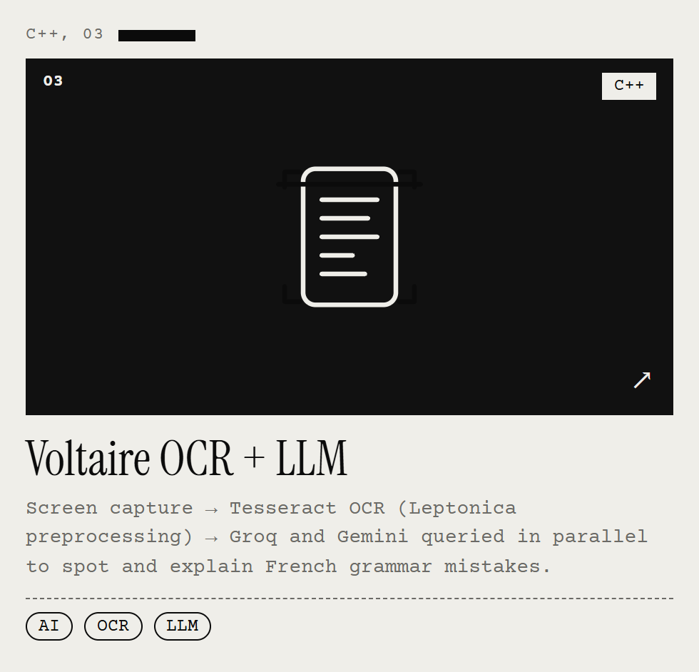</picture></a>
<a href="https://github.com/TomGlv/ai-lore-video-generator"><picture><source media="(prefers-color-scheme: dark)" srcset="assets/card-3-dark.png">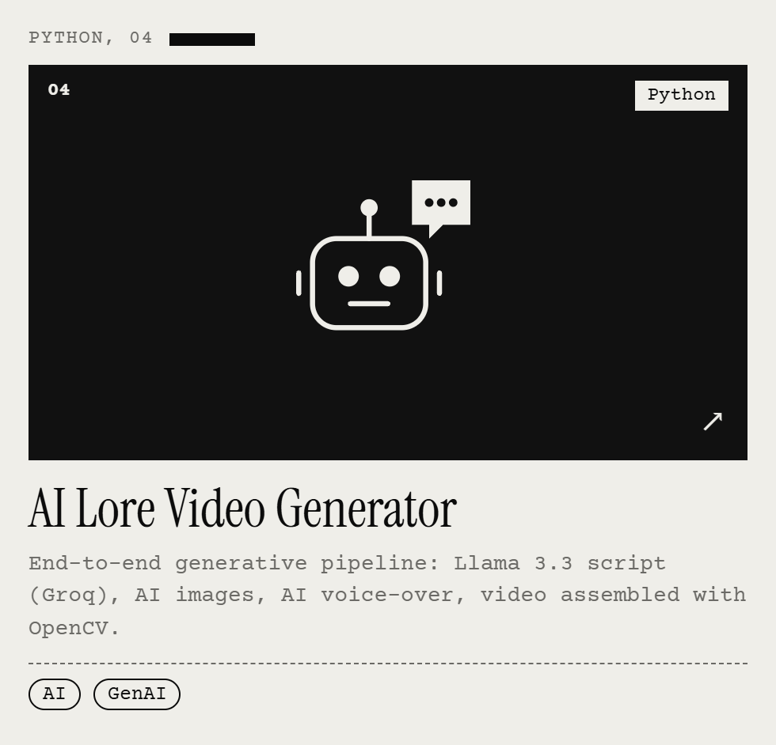</picture></a>

<a href="https://github.com/TomGlv/ml-scikit-learn-basics"><picture><source media="(prefers-color-scheme: dark)" srcset="assets/card-4-dark.png">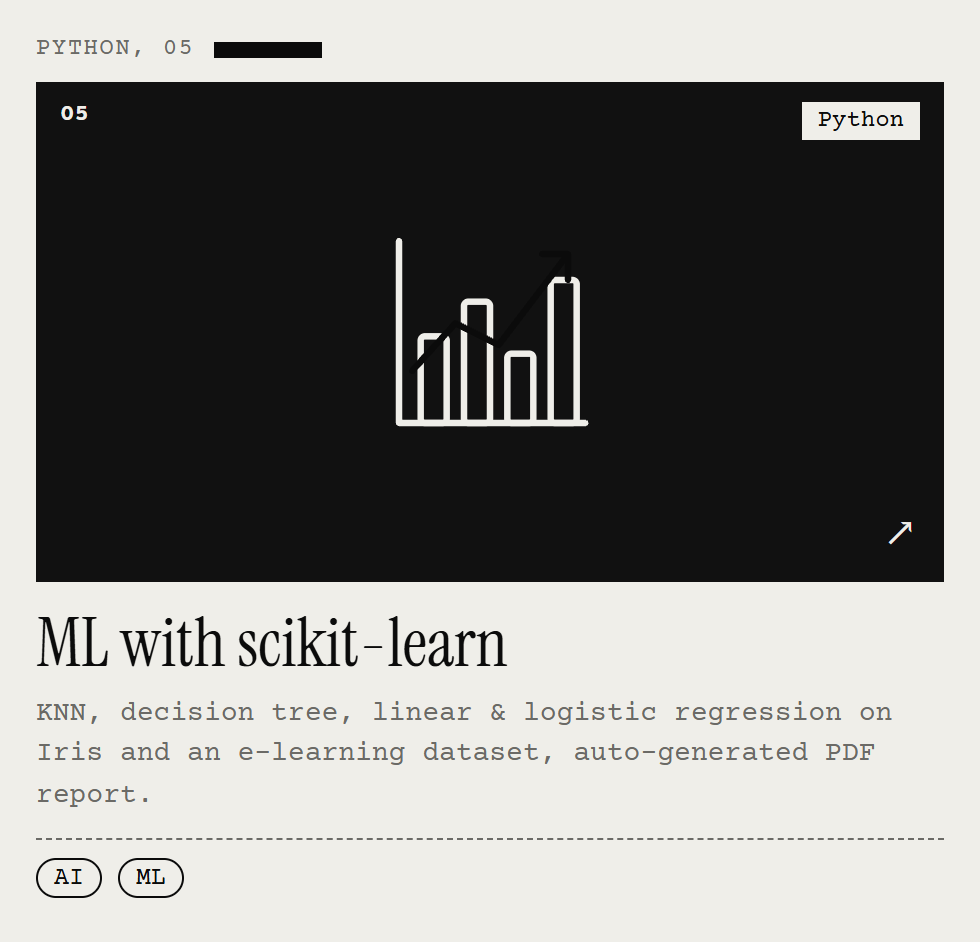</picture></a>
<a href="https://github.com/TomGlv/cinedeck"><picture><source media="(prefers-color-scheme: dark)" srcset="assets/card-5-dark.png">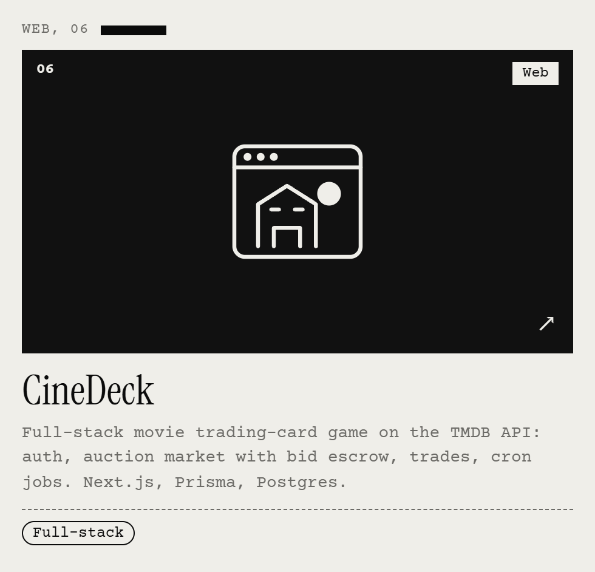</picture></a>

<a href="https://github.com/TomGlv/archidia-web"><picture><source media="(prefers-color-scheme: dark)" srcset="assets/card-6-dark.png">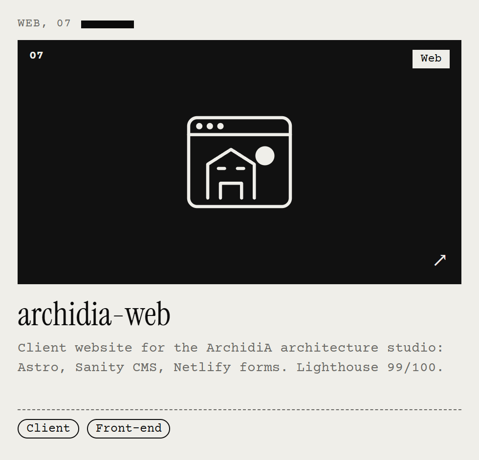</picture></a>
<a href="https://github.com/TomGlv/numerical-simulation"><picture><source media="(prefers-color-scheme: dark)" srcset="assets/card-7-dark.png">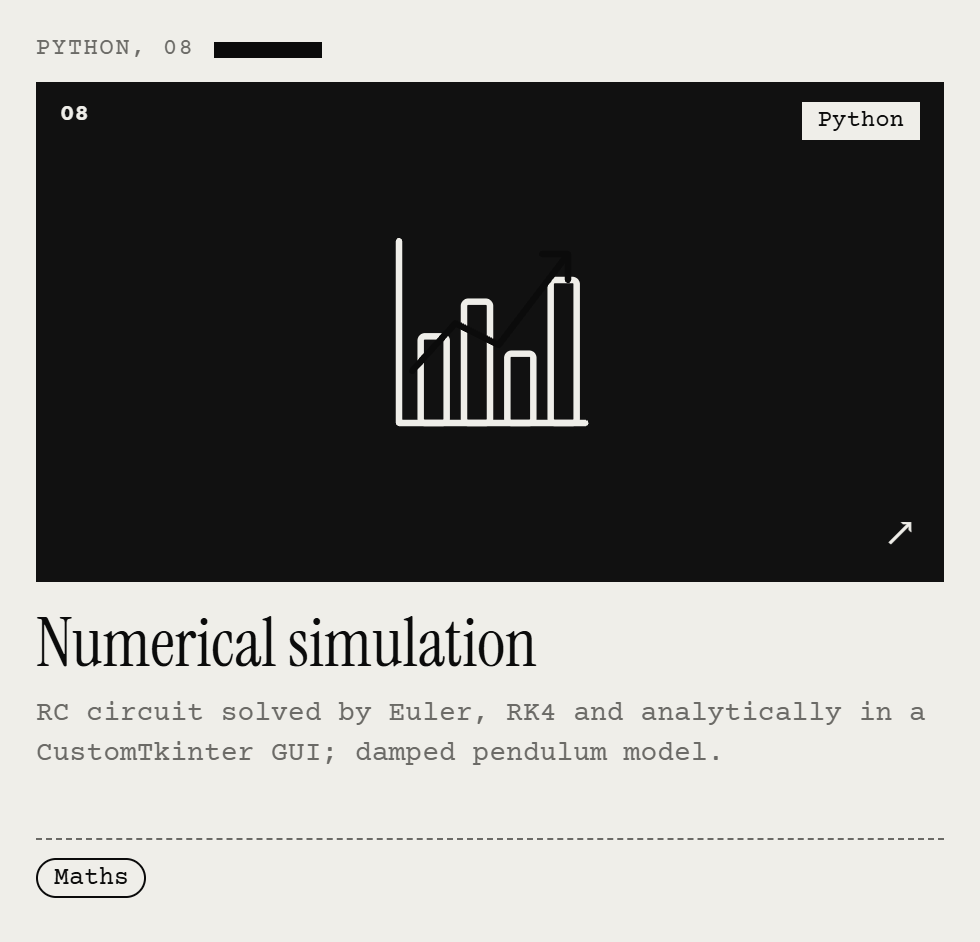</picture></a>

<a href="https://github.com/TomGlv?tab=repositories"><code>+ every other repo → git log --all</code></a>

<picture><source media="(prefers-color-scheme: dark)" srcset="assets/t-stack-dark.png">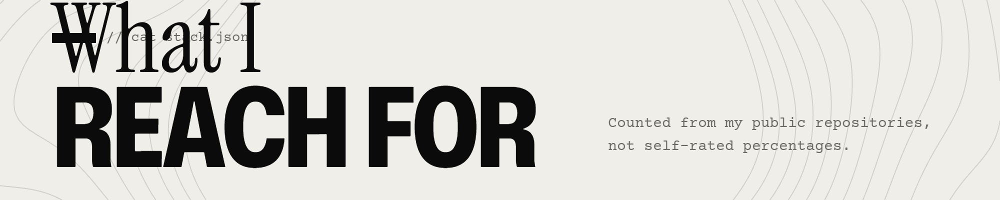</picture>

<picture><source media="(prefers-color-scheme: dark)" srcset="assets/stack-dark.png"></picture>

<a href="mailto:tom.galvan92@gmail.com"><picture><source media="(prefers-color-scheme: dark)" srcset="assets/footer-dark.png">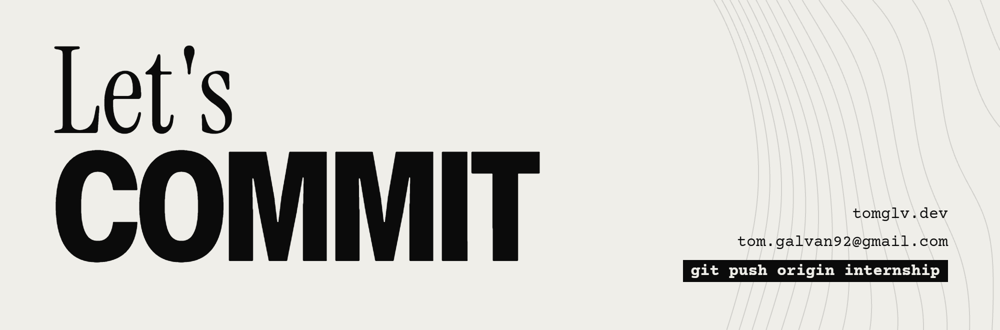</picture></a>

Same black & white design as <a href="https://tomglv.dev">tomglv.dev</a> — the visuals are rendered from <a href="_src/gen.html"><code>_src/gen.html</code></a> with the site&apos;s own fonts and icons.
