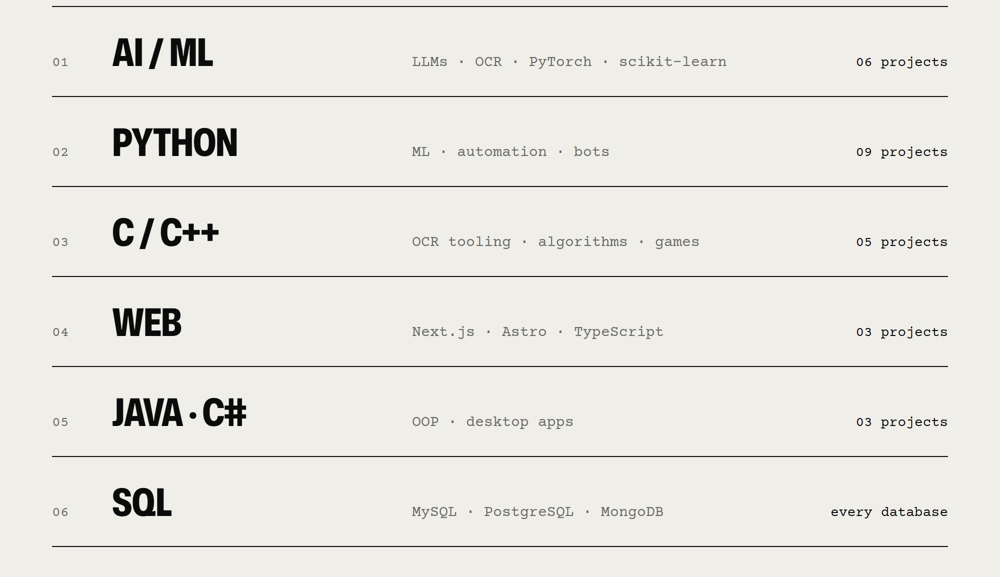

<a href="https://tomglv.dev"><picture><source media="(prefers-color-scheme: dark)" srcset="img/banner-dark.png"></picture></a>

Third-year **Bachelor in Artificial Intelligence** student at **ECE Paris**. I build end-to-end AI systems — data → model → API → UI — and measure them.

### Technical highlights

| Project | Approach | Stack | Result |
|---|---|---|---|
| [**BuildScan**](https://github.com/TomGlv/minecraft-house-ai) | NBT schematics → 32³ voxel grids + geometric features; RandomForest baseline vs 3D CNN; model served behind a REST API with a 3D viewer | PyTorch · scikit-learn · NumPy/SciPy · FastAPI · Docker · Three.js | **94.4 %** acc. (CNN) · 88.6 % (RF) |
| [**AI PDF Sorter**](https://github.com/TomGlv/ai-pdf-sorter) | Multimodal LLM reads handwritten scans → Pydantic-validated JSON; uncertain cases routed to a human queue; hash cache | Python · Claude vision API · Pydantic | Tesseract benchmarked and rejected on handwriting |
| [**Voltaire OCR + LLM**](https://github.com/TomGlv/voltaire-ocr-llm) | Screen capture → Leptonica preprocessing → Tesseract 5 → two LLMs queried in parallel over REST | C++ · Tesseract · libcurl · nlohmann/json · vcpkg | Native Windows tool, statically linked |
| [**AI Lore Video Generator**](https://github.com/TomGlv/ai-lore-video-generator) | LLM script + visual prompts → text-to-image → TTS → frames assembled into video, fallback at each stage | Python · Groq (Llama 3.3 70B) · OpenCV · pydub | Fully automated pipeline |
| [**ML with scikit-learn**](https://github.com/TomGlv/ml-scikit-learn-basics) | KNN, decision tree, linear & logistic regression, scaling, evaluation, auto-generated PDF report | pandas · scikit-learn · matplotlib | Accuracy, confusion matrix, R², MSE |
| [**Numerical simulation**](https://github.com/TomGlv/numerical-simulation) | RC circuit: Euler vs RK4 vs analytic solution; damped pendulum | NumPy · matplotlib · CustomTkinter | Error comparison between solvers |
| [**CineDeck**](https://github.com/TomGlv/cinedeck) | Full-stack game on the TMDB API: auth, auction market with escrow, trades, cron jobs | Next.js · TypeScript · Prisma · PostgreSQL | In production |

<picture><source media="(prefers-color-scheme: dark)" srcset="img/stack-dark.png"></picture>

<a href="mailto:tom.galvan92@gmail.com"><picture><source media="(prefers-color-scheme: dark)" srcset="img/footer-dark.png"></picture></a>
